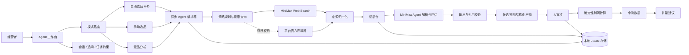

# 拾品 Agent 选品工作台架构

**版本：** V1.1（四层界面）  
**日期：** 2026-11-15

## 1. 架构决策

1. Agent 是产品主流程和研究执行者；人从三个任务模式发起工作并审核结果。
2. 聊天是统一的意图输入与追问界面；市场表格、商品卡、证据和运行状态作为结构化产物嵌在会话中。
3. 自动选品用四个策略作为发现规划器，不让用户先给商品名称。
4. 六步阶段由编排器推进，并在缺少数据或需要真实经营决策时显式暂停。
5. 外部平台接入按官方 API/授权范围实现；当前 MiniMax Web Search 只搜索公开网页，不声称直接接入 TikTok、Google Trends、Amazon、1688、淘宝或京东。
6. Agent 负责发现、筛选、摘要和提出建议；确定性代码负责权限、证据引用校验和利润计算；经营者审核候选和经营动作。

## 2. 总体架构

## 3. 交互模式和 Agent 工作流

### 3.1 自动选品

输入：四大策略 ID、目标市场、货源国家、经营画像和可选约束。

1. 搜索计划按选定策略生成趋势/内容、销售市场、货源查询。
2. MiniMax Web Search 每个 query 返回可追溯的 URL、标题和摘要。
3. 首次模型调用只能从真实搜索结果中提出候选并引用结果 ID。
4. 对候选自动发起销售市场和供应链二次搜索。
5. 第二次模型调用生成市场/货源初筛、建议保留/补证/淘汰及证据引用。
6. 服务端校验所有引用是否属于正确候选；只保存有效引用。
7. 写入候选并将 run 状态改为 `needs_human_review`；零候选则 `no_candidates`。
8. 前端轮询状态并显示进度，完成后展示候选审核卡片。

当前实现对一次策略运行最多执行 12 个搜索 query、产出最多 2 个候选；限制搜索数量和输出大小以控制成本与延迟。

### 3.2 手动选品

可输入具体商品/链接/痛点想法，或给定人群、类目和市场范围。路由把输入封装为 `manual_selection` Agent Run。若输入是范围，Agent 的输出仍应是具体候选；若输入是商品，则 Agent 评估其需求、竞品、供给和证据缺口。

### 3.3 手动竞品分析

输入类目、市场、平台、品牌或商品。路由封装为 `competitor_analysis` Agent Run，输出竞品列表和可比较字段，并保留“疑似同类”与“同规格同品”的差别。具体价格或评论缺失时不能填充模型猜测。

## 4. 六阶段编排和门槛

| 阶段 | 主要工具/组件 | 自动状态门槛 |
|---|---|---|
| 1 发现需求 | 公开网页搜索、未来有授权的趋势 API | 有可引用线索；否则 0 候选或需补证 |
| 2 验证市场 | Amazon JP、乐天、Yahoo 的官方连接器或公开搜索线索 | 区分商品目录/页面与摘要；来源缺失则 partial |
| 3 寻找货源 | 1688、工厂/产业带、淘宝/京东授权数据 | 只有正式报价才可记报价；否则线索待核实 |
| 4 利润核算 | 确定性 `calculate_profit`，用户报价/授权费用 | 关键费用齐全才显示完整估算；否则 blocked |
| 5 小批量测试 | 用户确认的实验项目与订单/广告数据导入 | 真实测试数据形成后才完成；不自动下单 |
| 6 扩大经营 | 实际利润、退货、供货与库存数据 | 达到用户阈值才生成扩量建议 |

Agent Run 和 Candidate 使用独立状态。Run 状态包括 `running`、`needs_human_review`、`no_candidates` 和 `failed`。阶段状态包括 `pending`、`partial`、`completed` 和 `blocked`；界面导轨额外用 `current` 表示“本次运行正在进行到此阶段”。候选不能因为 Agent 推荐就直接进入 ready-to-test。

## 5. 组件边界

### 前端

界面按四层组织：策略层（L1）→ 流程层（L2）→ 证据层（L3）→ 决策层（L4）。

- `public/index.html`：单页壳。顶栏放模式切换与状态 chip，左栏第一块是四大策略（最高层级），其下是最近会话、数据源入口与 Agent 状态。
- `public/app.js`：`renderShell()` 渲染模式与策略导航；`renderStrategyLayer()` 输出 L1 策略卡或研究范围卡；`renderFlowRail()` 输出 L2 六步导轨（状态取自运行阶段与候选的 `workflowStages`）；`renderHome()` 组合 L1/L2 与对话（L3）；候选卡与详情页承载 L4 审核动作、理由、四项独立判断与利润模型。
- `public/styles.css`：设计系统。深墨底 + 单一黄铜品牌色 + 语义状态色（绿/红/琥珀/蓝），三级表面，13–14px 正文，`--radius-s/m/l` 圆角，8px 间距栅格；顶栏状态 chip、流程导轨、建议短语 chip 与审核门（淘汰必填理由）沿用座舱测试 Agent 的交互做法。

审核动作经 `POST /api/candidates/{id}/review` 写入 `humanReview`（含 `reason`），理由随候选一起展示。

聊天 UI 不保存模型秘密、不直接调用 MiniMax 或外部平台。用户输入经同源 API 送入本地服务。

### HTTP 应用

- `GET /api/bootstrap`：候选、会话/运行记录、策略、六阶段、连接器和服务能力状态。
- `GET /api/metrics`：本地工作台的处理过程统计（候选与运行、来源覆盖、审核分布、淘汰理由、策略留存、小测与货源），不包含任何市场表现结论。
- `POST /api/agent/discovery`：异步启动自动选品。
- `POST /api/agent/chat`：按四种模式启动异步会话任务；手动竞品分析输出竞品报告，同品比价输出同配置差价表与差价候选，其他两种模式输出候选。
- `POST /api/candidates/{id}/review`：记录继续研究、暂缓或淘汰的人工审核决定。
- `POST /api/suppliers`：把某个店铺标记为货源候选并写入档案；`PATCH /api/suppliers/{id}` 更新跟进状态与备注。
- `build_supplier_comparison` 把一张询价单的书面答复并排比较（单价、MOQ、首单资金、交期、发票），标出最低价/最小起订/最快交期并计算回复率。
- `POST /api/purchase-orders`：由书面报价生成采购单草案（金额、预计到货日、状态历史）；`PATCH /api/purchase-orders/{id}` 记录人工推进的订单状态。系统不联系卖家、不付款、不发货。
- `POST /api/rfqs`：为同一商品向多家店铺生成询价单；`POST /api/rfqs/{id}/quotes`：录回一家店的书面报价，并同步写入货源档案的报价历史；带 `applyToCandidate` 时把该报价回填为候选的采购价，并生成一条“人工录入的询价回复”来源证据。
- `POST /api/discovery`（`trigger=price_gap_pair`）：用候选里的比价配对生成价差研究，先跑规格/包装匹配，匹配不通过不给价差结论，费用未填齐只报“待补费用”。
- 会话与运行结果暂存在本地 JSON store；`GET /api/bootstrap` 返回会话、消息和历史运行。
- `GET /api/agent/runs/{id}`：查询阶段进度和结果。
- 当前已有的候选、证据、评分、画像和利润端点仍由本地 Handler 管理。

本地原型使用 Python 标准库 `ThreadingHTTPServer`；Agent run 在 daemon thread 执行，JSON store 用线程锁和原子替换。正式部署需要后台队列和数据库，不能依赖 Web 进程内线程承载持久任务。

### Agent 编排器

- `prospector/platforms.py`：平台登记表。每个平台只描述一次——角色（`roles` 可多选：需求与内容侧 / 销售市场侧 / 货源侧）、销售市场（`sales_market`）、供给市场（`supply_market`）、地区、访问级别、授权通道、搜索关键词与站点归属。查询计划、连接器目录、经营画像和候选证据归类都读这张表；新增平台是改数据而不是改多处代码。目标市场（`MARKETS`：日本 / 中国 / 海外）决定销售平台清单，采购来源国决定货源平台清单。
- `prospector/strategies.py`：策略与六阶段目录。
- `calculate_batch_plan` 用首批数量与现金回本周期算资金占用与每日销量要求，不预测销量速度。
- `calibrate_assumptions` 把小测实测值（每单广告成本、退款率、净利率）与已填假设做对照，给出建议但不自动改写假设。
- `build_scale_plan` 在小测达标后按实测日均销量给出 30/45/60 天备货量、安全库存与资金占用，并与预算对照；`advance_candidate_workflow` 同时把阶段状态变化写入候选的 `timeline`。
- `evaluate_pilot` 用经营者录入的真实订单与投放数据，对照画像里的门槛（最少订单量、最高退款率、最低净利率）给出结论与建议；缺数据即「待补数据」，并据此推进六步流程的小测与扩量阶段。
- 利润模型有两种：`calculate_profit`（统一模型，售价与采购价各自带币种，跨币种时额外要求汇率、头程与关税）与旧的日元专用模型（`cross_border_jpy`，兼容早期保存的候选）。两者都缺输入即返回“待核验”，不用默认值补齐。
- `prospector/agent_discovery.py`：查询计划、候选生成、市场/货源复查、证据绑定；`_rejected_constraints` 把经营者写下的淘汰原因整理成“避免重复”的提示，只有在经营画像显式开启时才传入。
- `prospector/agent_pricegap.py`：同品跨平台比价（含同款店铺聚类与价格历史提醒）。逐个平台构造搜索式，从公开摘要里解析型号、内存/存储与价格，按“同配置”分组，只在同分组内计算差价；二手平台只作背景。可比分组会生成候选，候选只预填两端报价与各自币种，佣金、广告、履约、退货（跨币种再加汇率、头程、关税）由人填写后用统一利润模型计算。采购来源国与目标市场不同时会再扫一遍来源国平台，把两侧价格并排放出但不自动换算。`summarize_price_history` 把观察记录整理成每个平台/配置的价格序列与 ±5% 变化提醒；`gap_history` 用观察记录算出同一对平台的历史差价序列与中位数，用来判断本次差价是常规水平还是异常低价；分组里还会标记疑似促销页并给出“去除促销后的差价”与店铺级差价对；`compute_platform_profit` 用经营画像里的比价假设（可按平台覆盖佣金率）算出每个卖出平台在三种采购价基准（最低可见价、去促销最低价、同配置中位价）下的单件贡献利润，假设缺失时只报“待补费用”；`build_purchase_checklist` 生成采购待办清单，除价格外一律标成待确认或待执行；`merge_purchase_checklist` 只接受客户端的勾选状态、保留服务端措辞；`advance_candidate_workflow` 在待办全部确认后把“寻找货源”推进为已完成（利润阶段仍需费用齐全）。`build_price_gap_candidates` 把可比配对写成候选（含 `priceGap` 配对数据），供“生成价差研究”复用既有的规格/包装匹配校验。
- `prospector/llm/web_search.py`：MiniMax Coding Plan 官方 Web Search MCP stdio 客户端。

搜索结果按 URL 实际域名判定平台归属（`platform_for_url`），因为该后端把 `site:` 当提示而非过滤；证据的 `sourceType` 因此永远写实际来源平台，搜索式原目标写在备注里。证据维度按平台实际角色与当前研究范围归类（`platform_dimension`）：同一个平台在不同目标市场里角色不同——淘宝在目标市场为中国时是竞品，在“中国采购 → 日本销售”的范围里是国内货源对照。搜索式阶段只作为无法匹配平台时的兜底。
- `prospector/llm/minimax.py`：MiniMax Messages 模型客户端，密钥从环境或 Pi Agent 本机配置读取。
- `prospector/agent_runtime.py`：对已存在候选的专项任务分析。

Agent 输出是非可信建议；服务端按 JSON 格式、来源 ID、长度和状态规则校验。Agent 不写评分、不直接更改经营状态、不执行外部交易操作。

### Connector 适配器

未来每个平台实现独立 adapter：

- `search(query, market, scope) -> CollectionResult`
- `get_listing(external_id, scope) -> ListingSnapshot`
- `get_prices(ids, scope) -> PriceObservations`

每次响应必须包含连接器 ID/版本、权限 scope、观察时间、来源 URL、原始字段/快照引用、覆盖范围和错误状态。没有授权时返回 `authorization_required`，不使用浏览器登录态或绕过站点控制。

## 6. 数据模型

| 实体 | 核心字段 | 用途 |
|---|---|---|
| `Conversation` | id、模式、标题、市场约束、创建时间 | 关联用户意图和多轮追问 |
| `Message` | conversationId、role、text、attachments、timestamp | 保存用户要求和 Agent 可见回复 |
| `AgentRun` | id、conversationId、mode、strategyId、stage、status、progress、model、timestamps | 承载异步 Agent 工作 |
| `Candidate` | name、category、strategy、hypothesis、agentDiscovery、agentResearch、reviewDecision | 可审核商品候选 |
| `CompetitorSnapshot` | product/listing、market、platform、positioning、observed fields | 竞品表的单行快照 |
| `Evidence` | URL、title、query、snippet、observedAt、dimension、candidateId、connectorId | 结论来源 |
| `Listing` | platform、market、externalId、brand/model、variant、packCount、identifiers | 标准化商品刊登 |
| `PriceObservation` | listingId、amount、currency、availability、MOQ、observedAt、sourceId | 价格历史事实 |
| `CostScenario` | FX、logistics、tax、fulfillment、fees、ads、returns、source IDs | 确定性利润计算输入 |
| `ReviewDecision` | candidateId、decision、reason、reviewer、timestamp | 继续研究/暂缓/淘汰人工决策 |
| `ValidationExperiment` | candidateId、testWindow、spend、orders、conversion、refunds、netProfit | 小测与扩量的真实依据 |

当前 JSON 文件存储的实际字段会随阶段演进；上表是完整产品目标模型。多用户/团队环境迁移至关系型数据库并隔离租户。

## 7. 数据源访问策略

### 当前可用

MiniMax 官方 Coding Plan 提供 Web Search MCP。Agent 发起公开网页搜索，保存结果摘要和 URL，作为候选发现线索。它不等于直接访问某站商品 API，也不保证搜索引擎覆盖完整。

### 需进一步申请/接入

- Google Trends 官方 API 目前处于 Alpha，需满足申请条件；公开网页搜索不返回其原始趋势时间序列。
- TikTok Research API 面向符合条件的研究用途；商业选品需另找明确授权的商业数据或 Creative Center 适用能力。
- 抖音开放平台按应用类型、OAuth 与 scope 授权。
- Amazon SP-API、1688 开放平台、淘宝开放平台、京东零售开放平台和乐天/Yahoo API 需逐一确认当前接口权限、账户角色和可商业使用范围。
- 公开页面线索可帮助发现，不作为完整竞品/价格/热销排名事实。

开发时遵循官方文档：[MiniMax Web Search MCP](https://platform.minimax.io/docs/m-plan/mcp-guide)、[Google Trends API](https://developers.google.com/search/apis/trends)、[TikTok Research API](https://developers.tiktok.com/products/research-api/)、[抖音开放平台权限](https://open.douyin.com/platform/resource/docs/accession-guide/type-and-permission)、[Amazon SP-API](https://developer-docs.amazon.com/sp-api/docs/onboarding-overview)、[1688 开放平台](https://aop.alibaba.com/)、[淘宝开放平台](https://open.taobao.com/)、[京东零售开放平台](https://open.jd.com/)。

## 8. MiniMax 安全与请求生命周期

1. 服务端从 `MINIMAX_API_KEY` 或 `~/.pi/agent/auth.json` 的 provider key 读取凭证；模型和 base URL 从 Pi Agent 配置读取，并验证为受支持的官方 HTTPS host。
2. 搜索适配器启动官方 MCP 命令，用子进程环境传密钥，不将密钥写入 JSON、浏览器响应或日志。
3. 模型适配器将授权头写进临时权限受限文件，调用官方 Anthropic Messages 兼容接口，读完后清理临时目录。
4. 日志只记录请求路径和安全状态，不记录用户密钥、授权头和原始响应。
5. 搜索结果和用户粘贴文本均视为不可信内容；prompt injection 不执行。模型不得将页面文本中的指令当成系统权限。
6. 密钥泄露、撤销和轮换由本地凭证管理承担；生产部署应迁移到 KMS/Secret Manager。

## 9. 故障处理与降级

- Web Search 未配置：自动发现按钮禁用，提示检查 MiniMax 和 MCP。
- 搜索无结果：run 结束为 `no_candidates`，允许换策略或扩大/修改约束。
- 模型格式无效、引用不存在：不保存无效候选；运行返回失败或候选留待补证。
- 二次市场/货源搜索失败：保留候选但标记局部验证失败，利润保持 blocked。
- 官方连接器授权缺失：不尝试其他未授权方式，显示所需权限。
- 后台线程异常：run 需进入 failed，不能永远处于 running。
- 服务重启：当前 MVP 的运行线程不持久恢复；生产版需队列任务持久化、重试和幂等。

## 10. 演进路径

1. 完成当前自动选品与策略候选 MVP。
2. 建立三模式聊天交互与 conversation/message/run 持久化；支持 Agent 追问和模式专属结果卡。
3. 加入人工审核决策记录、竞品对比表、商品 listing 匹配和报价导入。
4. 依据已获批 API 权限逐个接入趋势、销售和供货数据源。
5. 用报价/平台费用构建确定性利润场景，接入小批量测试和真实订单结果。
6. 迁移到 ASGI API、PostgreSQL、持久队列、对象存储、认证/RBAC 和审计指标。

